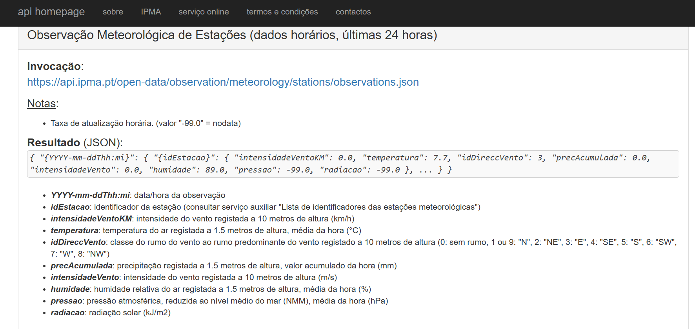

# IPMA

## Access via API

https://api.ipma.pt/

##  Live station observations

 [Hourly observations API, covering the last 24 hours](https://api.ipma.pt/open-data/observation/meteorology/stations/observations.json). 
 
 

 
 The data refresh hourly. The [station list](https://api.ipma.pt/open-data/observation/meteorology/stations/stations.json) gives station names, IDs and coordinates. 
 
 IPMA also provides a GeoJSON feed with recent observations.

Station names from main webpage: https://www.ipma.pt/pt/enciclopedia/redes.observacao/meteo/index.jsp

## Store in sqlite database

See https://github.com/rosatrancoso/ipma_data

 

